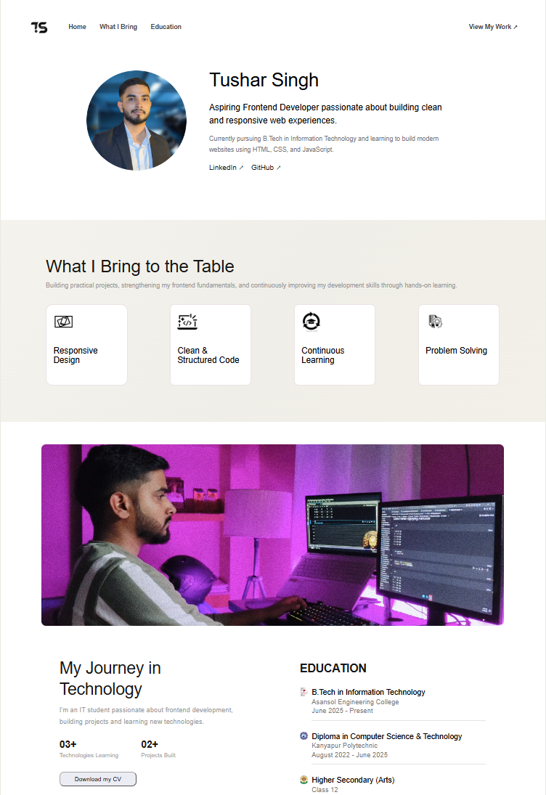

# Personal Portfolio Website

A personal portfolio website built using HTML, CSS and JavaScript to showcase my background, education and frontend development work.

## Live Demo

Check out the live website here: [Personal Portfolio](https://tushars1ngh.github.io/tushar-portfolio-2/)

## Preview



## About the Project

I built this portfolio website to put my frontend development knowledge into practice. Instead of only revising concepts through tutorials and examples, I wanted to use them to build a complete project on my own.

While working on it, I revisited HTML structure, CSS layouts, Flexbox, Grid, responsive design and JavaScript DOM manipulation. I also worked on the mobile navigation menu, hover effects and the overall layout of the website.

The main purpose of this project was to improve my existing skills, revise what I had learned and get more comfortable writing and organising code. It also gave me an opportunity to work through layout issues, fix bugs and make the website responsive across different screen sizes.

## Technologies Used

- **HTML5:** Used to structure the website and its content.
- **CSS3:** Used for layouts, styling, Flexbox, Grid, responsive design and hover effects.
- **JavaScript:** Used to handle the mobile navigation menu and its interactions.
- **Font Awesome:** Used for icons in the navigation menu.

## Features

- Personal introduction and profile section
- Education section
- Responsive layout for different screen sizes
- Mobile navigation menu with open and close functionality
- Hover effects and styled content cards
- Dedicated sections for personal information and areas of focus

## What I Worked On

Some of the main areas I worked on while building this project:

- Using Flexbox and CSS Grid to arrange content.
- Making the layout work on smaller screens using media queries.
- Using JavaScript event listeners and DOM methods to control the navigation menu.
- Adding hover effects and transitions to different elements.
- Organising the HTML, CSS, JavaScript and image assets into separate files.
- Testing the website and fixing layout and styling issues.

## Project Structure

```text
tushar-portfolio-2/
├── assets/
├── index.html
├── style.css
├── script.js
├── preview.png
└── README.md
```

## Run Locally

To run the project on your computer:

1. Clone the repository.

   ```bash
   git clone https://github.com/tushars1ngh/tushar-portfolio-2.git
   ```

2. Open the project folder.
3. Open `index.html` in your browser.

No additional dependencies or build tools are required.

## Future Improvements

I plan to keep improving the portfolio as I work on more projects and gain experience with frontend development.

## Author

**Tushar Singh**

- GitHub: [tushars1ngh](https://github.com/tushars1ngh)
